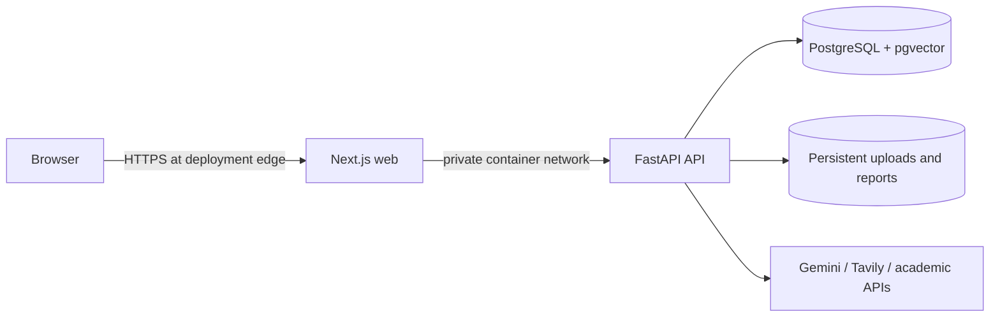

# ResearchOS deployment and release guide

This repository now includes a containerized single-host deployment baseline with a separate database-backed worker. It is suitable for local evaluation and controlled staging after secrets, storage, and provider access are configured. It is not a production certification: it has no built-in rate limiter, monitoring exporter, or tested disaster-recovery process.

## Services and data flow



Only the web service publishes a port in `compose.yaml`. The browser talks to the same-origin Next.js API proxy; the backend bearer token is held in an HttpOnly cookie. Put a TLS reverse proxy or managed ingress in front of `web` for any shared environment. Restrict ingress, add request-size and timeout policies, and keep PostgreSQL private.

## Start a local container deployment

1. Create `.env.docker` from `.env.docker.example`. Generate a long random hex database password and an independent secret key; do not commit the file. Add provider keys only in this ignored local file or in the deployment platform's secret manager.
2. Confirm Docker Desktop is running and that the host has enough memory and disk for PyTorch and model downloads.
3. Build and start:

   ```powershell
   docker compose --env-file .env.docker up --build -d
   docker compose --env-file .env.docker ps
   ```

4. Open `http://localhost:3000`. The API container waits for PostgreSQL health and applies Alembic migrations before starting Uvicorn.
5. Follow logs without dumping environment variables:

   ```powershell
   docker compose --env-file .env.docker logs --tail 100 api web worker
   ```

To stop without deleting persisted data, run `docker compose --env-file .env.docker down`. Do not use `down -v` unless you intentionally want to destroy the local database and uploaded artifacts.

## Provider configuration

- The project default is `gemini-3.5-flash-lite`, a stable model listed in Google's official [Gemini API model documentation](https://ai.google.dev/gemini-api/docs/models/gemini-3.5-flash-lite). The earlier 2.5 Flash model is deprecated and should not be used for new defaults.
- Gemini live calls require `GEMINI_API_KEY`; the key must not be committed or copied into documentation.
- Tavily live calls require a valid `TAVILY_API_KEY`. An earlier live check returned HTTP 401, so the key must be corrected or rotated before live verification. HTTP 401/403 provider responses are surfaced as credential rejection without dumping response payloads or secrets.
- Semantic Scholar is optional and can operate unauthenticated, but no-key requests are subject to rate limits. Set `SEMANTIC_SCHOLAR_API_KEY` only when a valid key is available. Crossref and arXiv can continue without provider keys, subject to network access and their public API policies.
- Crossref should receive `CROSSREF_MAILTO` as the operator contact for polite-pool identification; it may remain empty for basic use.

## Secrets and storage

- Keep `.env.docker`, backend `.env`, and frontend `.env.local` out of source control. Set production secrets through the hosting provider's secret manager.
- Set `SECRET_KEY` to a unique high-entropy value. Rotating it invalidates active access tokens.
- Use a PostgreSQL 18 image with pgvector available. Keep `postgres_data`, `research_files`, and `research_reports` on encrypted persistent storage with separate access controls.
- Keep a persistent model cache or pre-download the configured embedding/reranker models during image preparation. First-time model downloads require outbound network access.
- The local Compose file stores password interpolation as a URL. It expects a hexadecimal password to avoid URL-encoding ambiguity.
- Use a managed database/storage product with private networking, encryption, automatic backups, and restore points for production.

## Upgrade and rollback

Before each release, create and verify a database backup and snapshot the file volumes. Review pending Alembic migrations; migrations run automatically when the API container starts. For a controlled release, back up first, deploy the candidate to staging, apply migrations, run the smoke tests below, then shift traffic. If a release fails, roll back the application image. A migration may require a forward fix; do not assume a previous image can use a newer schema. Restore database and file snapshots together when rollback needs data restoration.

Example PostgreSQL backup/restore commands for a separately provisioned database:

```powershell
pg_dump --format=custom --file=researchos.dump --dbname=$env:DATABASE_URL
pg_restore --list researchos.dump
```

Perform restore drills against a disposable database. No restore drill has been completed for this project.

## Release checks

Locally, run backend pytest with a local `TEST_DATABASE_URL` that names a disposable `researchos_test*` database, and run frontend typecheck, lint, and production build. In staging, verify `/health`, `/api/v1/database/check`, registration/login, ownership isolation, upload/index/search, one mocked or provider-backed research run, source/claim provenance, and report download. Check migration head and database connectivity. Never characterize provider integration as live-tested unless credentials were configured and calls succeeded.

## Production blockers still open

- Rate limits and abuse controls, run-level correlation, metrics, alerting, and error reporting.
- Staging load and timeout tests, database backup/restore exercise, migration/rollback exercise, and live provider/model tests.
- A hosting-specific TLS, secret management, persistent storage, scaling, and operational ownership plan.

Until those are completed in an explicitly provisioned environment, this setup is a deployment baseline rather than a production-ready service.
